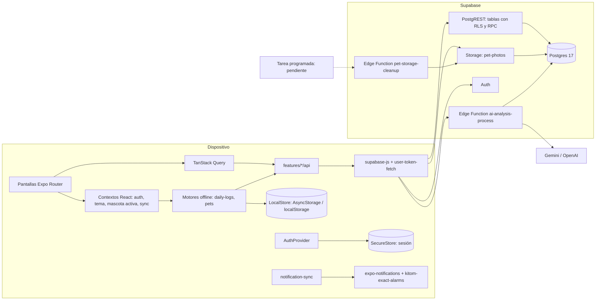
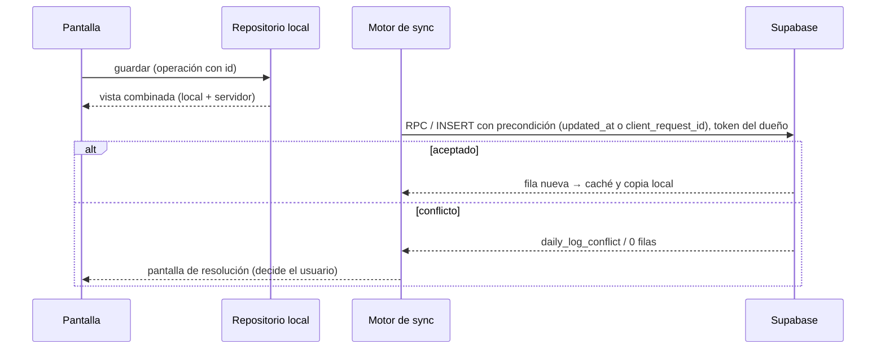
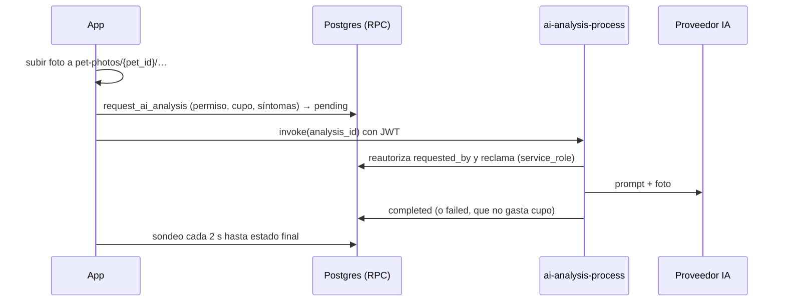

# Kitom — Arquitectura

Visión general y mapa de módulos (revisión 2026-10-29). Es la puerta de entrada: el detalle está en
[`FRONTEND_ARCHITECTURE.md`](FRONTEND_ARCHITECTURE.md) (contrato pantalla ↔ datos, modo offline,
sesión), [`docs/README.md`](README.md) (arquitectura SQL y contrato de RPC/Edge Functions),
[`DATABASE.md`](DATABASE.md) (estado desplegado), [`AUTH.md`](AUTH.md) y [`DECISIONS.md`](DECISIONS.md).

## 1. Piezas

| Capa | Tecnología (versión real) |
|---|---|
| App | Expo SDK 57 (`expo ~57.0.30`), React Native 0.86.3, React 19.2.3, TypeScript ~6.0, React Compiler y rutas tipadas activados |
| Navegación | Expo Router 57 (`Stack.Protected` en `src/app/_layout.tsx`) |
| Estado de servidor | TanStack Query 5 (`lib/query-client.ts`, `lib/query-defaults.ts`) |
| Estado local | React Context; nada de Redux/Zustand (decisión cerrada) |
| Datos | `@supabase/supabase-js` 2.117 |
| Persistencia | SecureStore (sesión, por trozos), AsyncStorage (`lib/local-store`, sin cifrar) |
| Backend | Supabase: Postgres 17, Auth, Storage, Edge Functions (Deno 2) |
| IA | Gemini (Google AI Studio) por defecto, OpenAI alternativo, `mock` solo en local |
| Nativo propio | `frontend/modules/kitom-exact-alarms` (Android, Kotlin, autolinking): requiere build nativa, no Expo Go |

## 2. Mapa de módulos (`frontend/src`)

| Módulo | Responsabilidad |
|---|---|
| `app/` | rutas: `(auth)` sin sesión, `(app)` con sesión (`(tabs)` Hoy · Historial · Registrar · Agenda · Perfil; `pets/[id]/…`, `reminders/…`, `settings/…`, `setup/…`), `update-password` (sesión de recuperación), `dev-components` (solo `__DEV__`) |
| `features/auth` | `AuthProvider`/`useAuth`, estados `loading`/`signed_in`/`offline`/`signed_out`, `serverCall`, deep links PKCE, cierre de sesión con pendientes |
| `features/pets` | mascotas: API, motor offline (`offline/`, `sync/`), fotos, razas, mascota activa |
| `features/daily-logs` | registro de hoy, historial, motor offline con conflictos |
| `features/reminders` | agenda y recordatorios (solo con conexión) |
| `features/notifications` | programación de avisos locales a partir de los recordatorios |
| `features/ai-analysis` | consultas: foto, síntomas, cupo, resultado con sondeo |
| `features/co-owners` | invitaciones y miembros (solo RPC) |
| `features/achievements`, `features/profile` | logros; perfil, onboarding, zona horaria |
| `lib/` | cliente Supabase, guardas de token y de renovación, conectividad, `LocalStore`, ids de operación, errores de servidor, `single-flight`, `submit-guard` |
| `components/ui/` | sistema de diseño «Ritmo» (botones, campos, listas, gráficos, calendario, hojas, avisos) |
| `theme/`, `i18n/` | tokens y tema claro/oscuro; textos `es`/`en` tipados (idioma activo fijo `es`) |

## 3. Flujos de datos clave

**Lectura online**: pantalla → hook de TanStack Query (query key con `userId`) → `features/*/api` →
`serverCall` (falla al instante sin sesión utilizable) → PostgREST con el JWT del usuario → RLS.

**Escritura offline (registros y mascotas)**:

**Consulta con IA**:

## 4. Autenticación y autorización

- Autenticación: email/contraseña y Google (PKCE con `kitom://auth-callback`); detalle en [`AUTH.md`](AUTH.md).
- Protección de rutas en un único sitio (`app/_layout.tsx`); el estado `offline` cuenta como sesión
  para leer datos locales, pero no habla con el servidor.
- Autorización: siempre en la base (grants de columna + RLS + triggers + RPC `SECURITY DEFINER` que
  comprueban `auth.uid()`); el cliente nunca decide propietario, plan, cupo ni estado de IA.
- Las Edge Functions reautorizan contra la base antes de usar `service_role`.

## 5. Entornos

Local (Docker + `npm run start:local`), `kitom-dev` (único remoto) y producción (**no existe**). Ver
[`DEPLOYMENT.md`](DEPLOYMENT.md).

## 6. Deuda de arquitectura

- Listas con `ScrollView` + `map` (`components/ui/screen.tsx`): sin virtualización.
- Módulos muy grandes en el motor de mascotas (`pet-operation.ts`, `pet-sync-engine.ts`).
- Agenda sin modo offline mientras registros y mascotas sí lo tienen (propuesta en `docs/proposals/`).
- Sin capa de observabilidad (errores y rendimiento) ni analítica.
