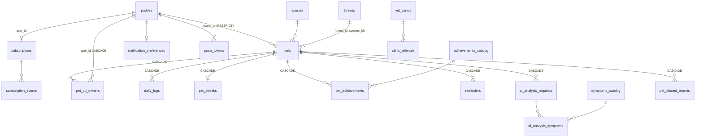

# Kitom — Base de datos (estado desplegado)

Revisión: **2026-10-29**. Fotografía del esquema **realmente desplegado** (`supabase/migrations/`,
13 migraciones, idénticas en `kitom-dev`), de su cobertura de pruebas y de sus problemas conocidos.
El **contrato** (matriz de permisos, RPC, códigos de error, Edge Functions) está en
[`docs/README.md`](README.md) y no se repite aquí; las decisiones, en [`DECISIONS.md`](DECISIONS.md);
las reglas de trabajo, en [`supabase/CLAUDE.md`](../supabase/CLAUDE.md).

## 1. Migraciones

| Migración | Qué hace | Remoto |
|---|---|---|
| `20261006175453_remote_schema` | volcado base (equivale a `database/v2.2.1/` 00–26, sin `organizations`) | aplicada |
| `20261007152630_breeds` | catálogo `breeds`, `pets.breed_id`/`breed_status` | aplicada |
| `20261007172110_pets_select_policy_owner` | SELECT de `pets` comprueba `owner_id` primero (`INSERT … RETURNING`) | aplicada |
| `20261007182429_grant_safe_pet_id_from_path` | EXECUTE para las políticas de Storage | aplicada |
| `20261008150202_daily_logs_fixes` | rachas, cascada, RPC `save_daily_log`, ventana de 7 días, CHECKs | aplicada |
| `20261008155257_profile_timezone` | `profiles.timezone` nullable y validada | aplicada |
| `20261010160332_daily_logs_concurrency` | precondiciones de versión en `save_daily_log` | aplicada |
| `20261020135440_pets_client_request_id` | alta idempotente de mascotas | aplicada |
| `20261023082848_pet_invitations_by_email` | 3 RPC de co-tutores por email | aplicada |
| `20261027194904_pets_photo_path_own_pet` | CHECK de `photo_path` dentro de la carpeta propia | aplicada |
| `20261027194908_pet_storage_cleanup` | cola `private.pet_storage_cleanup_jobs` + RPC de servicio | aplicada |
| `20261028114317_pet_storage_cleanup_guards` | salvaguardas de las RPC de limpieza | aplicada |
| `20261028200659_reminders_is_active` | activar/desactivar recordatorios | aplicada |

Procedimiento (resumen; completo en `supabase/CLAUDE.md` y [`DEPLOYMENT.md`](DEPLOYMENT.md) §5):
migración nueva → `migration up --local` → pgTAP → PR `db/…` → `db push` **del usuario** → tipos con
`gen types --linked`. Nunca editar una migración aplicada.

## 2. Tablas (23 en `public`, todas con RLS) y relaciones

| Grupo | Tablas | Escritura desde el cliente |
|---|---|---|
| Usuario | `profiles`, `notification_preferences`, `push_tokens`, `subscriptions`, `subscription_events` | perfil (columnas concretas), preferencias y tokens propios; plan **nunca** |
| Mascota | `pets`, `pet_co_owners`, `pet_streaks`, `pet_achievements` | `pets` (dueño/editores, columnas concretas); co-tutores solo por RPC; rachas y logros solo la BD |
| Registro | `daily_logs`, `reminders` | editores (en la práctica `save_daily_log`) |
| IA | `ai_analysis_requests`, `ai_analysis_symptoms` | solo por RPC; estado lo escribe la Edge Function con `service_role` |
| Catálogos | `species`, `breeds`, `catalog_translations`, `symptoms_catalog`, `symptom_species`, `achievements_catalog`, `vet_clinics` | lectura para `authenticated` |
| Otros | `clinic_referrals`, `pet_shared_reports`, `analytics_events` | por RPC / solo backend / INSERT propio |
| `private` | `pet_storage_cleanup_jobs` | ninguna (sin `USAGE` del esquema) |

Borrados: borrar una mascota arrastra registros, recordatorios, rachas, logros, co-tutorías, informes y
**análisis de IA** (ver problema D-01) y encola la limpieza de sus fotos. Borrar un usuario de `auth`
arrastra su perfil, pero **falla si es dueño de alguna mascota** (`pets.owner_id … RESTRICT`).

## 3. RLS y cobertura de pruebas

Políticas por tabla y su significado: matriz de [`docs/README.md`](README.md) §5. Lo que añade este
documento es si cada fila está **demostrada** por pruebas (pgTAP en `supabase/tests/database/` o
concurrencia en `supabase/tests/concurrency/`):

| Tabla / superficie | Políticas | Probada |
|---|---|---|
| `daily_logs` + `save_daily_log` | S/I/U/D | sí (186 casos pgTAP + concurrencia) |
| `pets` | S/I/U/D | sí (pgTAP `pets_*`, concurrencia de alta/edición/borrado) |
| `profiles` | S/I/U | parcial (zona horaria y aislamiento entre usuarios) |
| `reminders` | S/I/U/D | sí (`reminders.test.sql`, `reminders_is_active.test.sql`) |
| `pet_co_owners` + RPC de invitación por email | S + RPC | parcial (por email sí; `change_pet_member_role`, `revoke`, `decline`, `invite_pet_member` por id, no) |
| `private.pet_storage_cleanup_jobs` + RPC | ninguna (servicio) | sí (pgTAP + concurrencia + integración) |
| Storage `pet-photos` | S/I/D | parcial (subida durante el borrado; SELECT/DELETE entre usuarios, no) |
| `ai_analysis_requests`, `ai_analysis_symptoms`, `request_ai_analysis`, `get_ai_analysis_entitlement`, `submit_ai_feedback` | S + RPC | **no** |
| `subscriptions`, `subscription_events`, `process_revenuecat_event` | S | **no** |
| `push_tokens`, `notification_preferences`, `analytics_events`, `clinic_referrals`, `vet_clinics`, `pet_shared_reports`, catálogos | varias | **no** |
| `transfer_pet_ownership` | RPC | **no** |
| Storage `avatars`, `reminder-attachments`, `shared-reports` | varias | **no** |

## 4. Funciones y triggers

- **RPC para el cliente** (todas `SECURITY DEFINER` con `search_path` fijo, salvo `save_daily_log`, que
  es INVOKER): invitaciones (`invite_pet_member[_by_email]`, `accept/decline/revoke_pet_invitation`,
  `change_pet_member_role`, `get_my_pet_invitations`, `get_pet_members`), `transfer_pet_ownership`,
  `request_ai_analysis`, `get_ai_analysis_entitlement`, `submit_ai_feedback`, `request_generate_report`,
  `register_push_token`, `create_clinic_referral`, `owner_has_pets`, `save_daily_log`; ayudantes de
  políticas `is_pet_member`, `can_edit_pet`, `safe_pet_id_from_path`.
- **Solo servidor** (`service_role`): `claim_ai_analysis_for_processing`, `award_pet_achievement`,
  `recompute_pet_streak`, `process_revenuecat_event`, `pet_storage_cleanup_*`.
- **Triggers**: `handle_new_user` (perfil + preferencias + suscripción free al registrarse);
  `set_timestamp_*`; protección de campos (`trg_protect_pet_structural_fields`,
  `trg_protect_daily_log_audit`, `trg_protect_reminder_audit`); validaciones (fecha del registro,
  nacimiento, zona horaria, ruta de foto de IA, adjunto de recordatorio, especie del síntoma); rachas
  (`trg_daily_logs_streak`, concede logros); `trg_sync_reminder_completion`;
  `trg_pets_enqueue_storage_cleanup` (`AFTER DELETE`).

## 5. Storage

| Bucket | Remoto | Ruta | Políticas | Límites |
|---|---|---|---|---|
| `pet-photos` | privado | `{pet_id}/…` | leer miembros; subir y borrar editores | **ninguno** (SEC-07) |
| `avatars` | privado | `{user_id}/…` | propio | ninguno; sin uso en la app |
| `reminder-attachments` | privado | `{pet_id}/…` | como `pet-photos` | ninguno; sin uso en la app |
| `shared-reports` | privado | — | leer miembros | ninguno; sin uso en la app |

Los buckets se crearon a mano en `kitom-dev`; en local solo existe `pet-photos` (`config.toml`). Su
configuración no está versionada (ver P0-01 en [`ROADMAP.md`](ROADMAP.md)).

## 6. Índices y avisos del linter (remoto, 2026-10-28)

- 12 claves foráneas sin índice (p. ej. `pet_shared_reports.pet_id`, `reminders.created_by`,
  `push_tokens.user_id`, `pets (breed_id, species_id)`).
- 22 políticas con `auth.uid()`/`auth.role()` sin `(select …)` (`auth_rls_initplan`): se evalúan por fila.
- `is_pet_member` y `can_edit_pet` sin `STABLE`.
- 11 índices sin uso todavía (normal con pocos datos; no borrar).
- Seguridad: ver [`SECURITY_AUDIT.md`](SECURITY_AUDIT.md) (SEC-11, SEC-12).

Con el volumen actual no hay impacto medible; son tareas P2 antes de crecer.

## 7. Problemas conocidos

| ID | Problema | Ref. |
|---|---|---|
| D-01 | La cuota de IA cuenta filas que desaparecen al borrar la mascota | SEC-01 |
| D-02 | Invitación por email revela cuentas y acepta emails sin confirmar | SEC-04, SEC-05 |
| D-03 | `request_ai_analysis` no exige el aviso veterinario | SEC-10 |
| D-04 | `pets.owner_id … RESTRICT` impide borrar cuentas con mascotas sin una función que lo gestione | SEC-02 |
| D-05 | Configuración de buckets fuera de migraciones y sin límites | SEC-07 |
| D-06 | Privilegios `TRUNCATE`/`TRIGGER`/`REFERENCES` sobrantes; DML de `anon` | SEC-11 |
| D-07 | Sin límites de longitud en varios textos | SEC-18 |
| D-08 | La limpieza de Storage no puede programarse: el remoto no tiene `pg_cron` ni `pg_net` | `ROADMAP.md` P1-04 |
| D-09 | `catalog_translations` polimórfica, `recurrence_rule` con validación básica, co-tutores sin avatares ajenos | `docs/README.md` §22 |
| D-10 | Sin entorno de producción: `kitom-dev` es el único remoto | [`DEPLOYMENT.md`](DEPLOYMENT.md) |

Copias de seguridad: dependen del plan de Supabase del proyecto (en el plan gratuito no hay
recuperación a un momento dado); no hay procedimiento de restauración probado.
